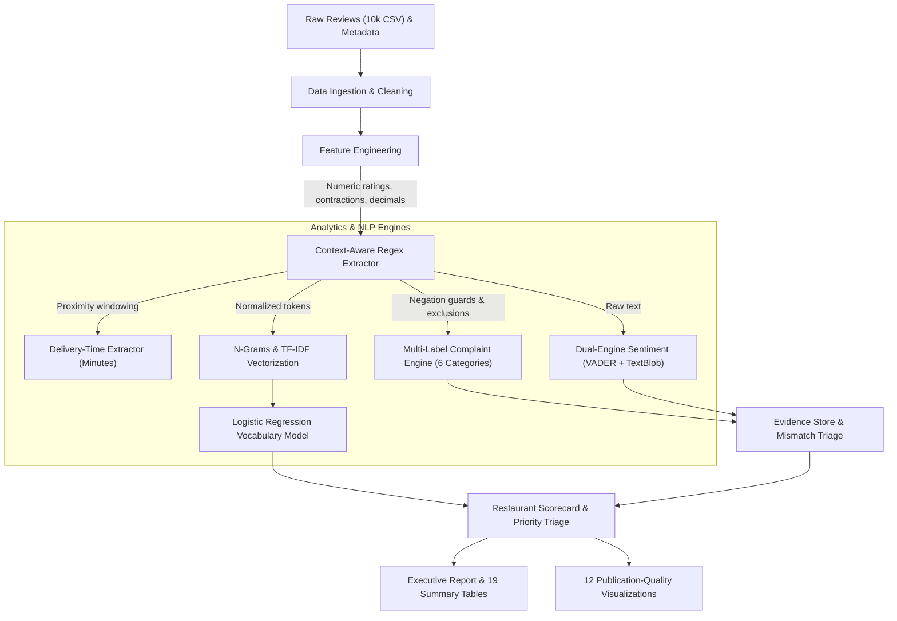
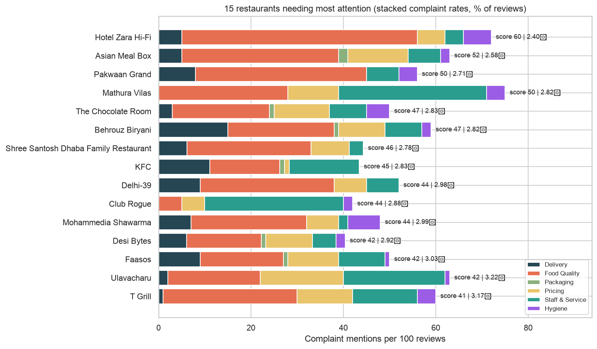
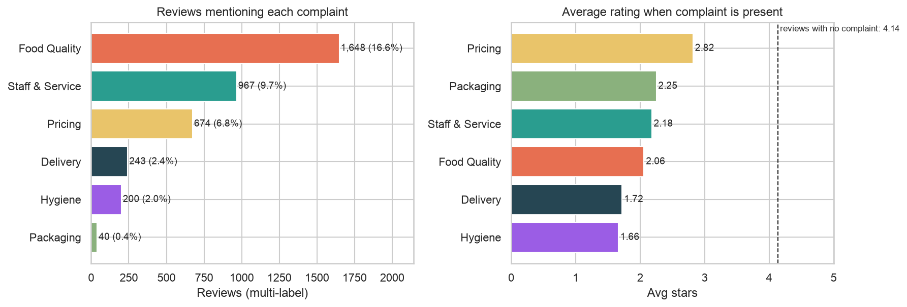
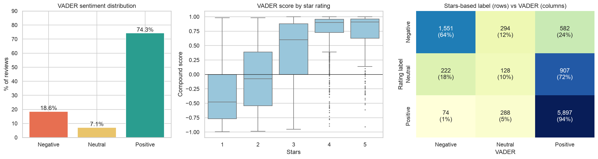
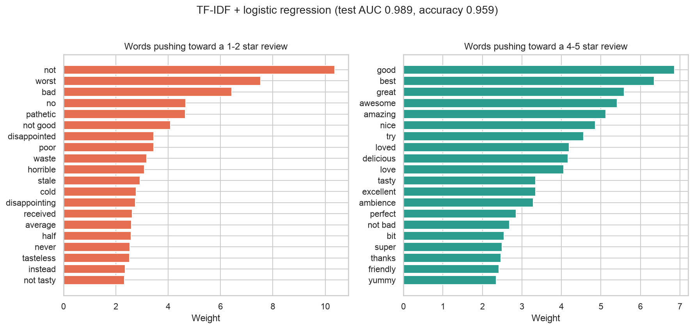

# 🍽️ Customer Review Intelligence Engine
### *End-to-End NLP, Multi-Label Complaint Auditing & Restaurant Operations Scorecard*

[](https://www.python.org/)
[](https://pandas.pydata.org/)
[](https://scikit-learn.org/)
[](https://github.com/cjhutto/vaderSentiment)
[](tests/test_rules.py)
[](#)

---

## 📌 Executive Summary

Online customer reviews are often noisy, unstructured, and difficult to translate into operational changes. While star ratings indicate *customer dissatisfaction*, they fail to explain **why** or **what specific action** management should take.

**Customer Review Intelligence** is a production-grade analytics and NLP pipeline built on **10,000 real-world Zomato customer reviews** across 100 restaurants in Hyderabad, India. The engine processes unstructured review text into:
1. **Explainable Multi-Label Complaint Categories** with captured phrase-level evidence.
2. **Context-Aware Sentiment & Rating Mismatch Auditing** (VADER + TextBlob vs. star ratings).
3. **Statistical N-Gram & TF-IDF Drivers** revealing vocabulary associated with severe rating drops.
4. **An Executive Restaurant Attention Scorecard** that prioritizes venues needing intervention and identifies the operational root cause (Kitchen, Floor Staff, or Delivery Logistics).

> 📄 **Complete Deep-Dive Report:** For detailed statistical breakdowns, business recommendations, and methodology, see [`reports/PROJECT_REPORT.md`](reports/PROJECT_REPORT.md).

---

## 📊 Key Business & Analytical Findings

| Metric | Value | Executive Insight |
| :--- | :---: | :--- |
| **Total Analyzed Reviews** | **9,944** | 56 non-informative rows cleaned (empty, emojis-only, non-numeric ratings). |
| **Classifiable Complaint Rate** | **29.6%** | Nearly 1 in 3 reviews identifies an actionable operational breakdown. |
| **Complaint Rating Penalty** | **-1.82★** | Reviews with a complaint average **2.32★** vs. **4.14★** without complaints. |
| **#1 Volume Lever** | **Food Quality** | 16.6% of all reviews (56% of all complaints). Drops ratings by -1.84★. |
| **Most Lethal Complaints** | **Hygiene & Delivery** | Drop ratings by **~2.0★**; >78% of these reviews receive 1-2★. |
| **VADER Polarity Agreement** | **91.9%** | Strong alignment with ratings; highlights **295 "silent dealbreaker"** reviews. |
| **Negative Vocab Predictor** | **0.989 AUC** | TF-IDF + Logistic Regression achieves 95.9% accuracy detecting 1-2★ reviews. |

---

## 🏗️ Architecture & Pipeline Workflow



---

## 🔬 Core Engineering & NLP Innovations

### 1. Robust Token Cleaning & Negation Preservation
* **Contraction Expansion Before Stripping Punctuation**: Prevents `didn't` from becoming `didn t` (which previously severed negations).
* **Decimal Point Protection**: Preserves values like `1.5 hours` (preventing legacy errors that converted `1.5` to `1 5` $\rightarrow$ 5 hours / 300 minutes).

### 2. Context-Aware Proximity Windowing for Delivery
* Reviews mentioning *"ordered and waited 30 minutes at the table"* represent **dine-in floor delays**, not delivery delays.
* The engine uses an 80-character directional window enforcing delivery-context keywords (`swiggy`, `zomato`, `rider`, `courier`, `packed`, `delivered`) before extracting numeric minutes.

### 3. Multi-Label Complaint Engine with Evidence Capture
Classifies reviews across 6 business-critical categories:
* **Food Quality** (stale, undercooked, raw, cold, salty, tasteless)
* **Staff & Service** (rude, delayed seating, ignored, billing disputes)
* **Pricing & Value** (overpriced, small portion, hidden charges)
* **Delivery** (late delivery, cold transit, unassigned riders)
* **Hygiene** (insects, hair, dirty tables, foul odor, sanitation)
* **Packaging** (spilled gravy, damaged boxes, broken seals)

Every category applies:
* **Negation Guards**: Window-based lookback (`not rude`, `never late` are suppressed from complaints).
* **Domain Exclusions**: False-friend exclusion lists (`late night`, `spill proof`).
* **Traceable Evidence**: Stores the exact matched snippet in `complaint_evidence`.

### 4. Dual-Stream Sentiment & Rating Mismatch Triage
* **Raw vs. Cleaned Stream**: VADER runs on **raw reviews** to exploit capitalization (`AWFUL`), exclamation points (`!!!`), and emojis. TF-IDF and n-grams run on **cleaned reviews**.
* **Rating Mismatch Discovery**: Flags reviews where stars and sentiment diverge. Discovered **295 reviews** with 1-2★ ratings but high sentiment scores—reading these reveals polite text praising ambience where a single dealbreaker (e.g., hair in food or extreme delay) ruined the visit.

---

## 📈 Visual Gallery

### 1. Restaurant Attention Scorecard (`outputs/figures/08_restaurant_priority.png`)
*Ranks the top restaurants requiring intervention, decomposing their complaint profiles by category to direct operational fixes (Kitchen vs. Staff vs. Logistics).*


### 2. Complaint Volume vs. Star-Rating Penalty (`outputs/figures/02_complaint_categories.png`)
*Shows frequency alongside rating drops. Food Quality has the highest volume, while Hygiene and Delivery cause the sharpest drop.*


### 3. Sentiment Polarity vs. Star Rating Distribution (`outputs/figures/04_sentiment_vs_rating.png`)
*Demonstrates strong 92% polarity agreement and uncovers mixed-sentiment reviews.*


### 4. Discriminative Word Importance (`outputs/figures/06_word_importance.png`)
*L1/L2 penalized coefficients identifying terms driving negative vs. positive ratings.*


---

## 📂 Repository Structure

```text
├── data/
│   ├── restaurant_reviews.csv        # Raw dataset (10,000 reviews across 100 venues)
│   ├── restaurant_metadata.csv       # Restaurant metadata (cost for two, cuisines)
│   └── processed/
│       └── reviews_enriched.csv      # Enriched dataset (9,944 rows x 49 analytical columns)
├── notebooks/
│   ├── 01_data_understanding.ipynb   # Raw schema audit, nulls, duplicates & distributions
│   ├── 02_text_cleaning_and_regex.ipynb # Regex exploration & delivery-time parsing logic
│   ├── 03_complaint_categorization.ipynb # Rule architecture, negation guards & validation
│   ├── 04_sentiment_and_nlp.ipynb    # VADER, TextBlob, n-grams, TF-IDF & LR modeling
│   └── 05_business_insights.ipynb    # Scorecards, pricing segments & strategic actions
├── outputs/
│   ├── headline_metrics.json         # Automated summary metrics for reporting
│   ├── figures/                      # 12 publication-ready charts (PNG)
│   └── tables/                       # 19 analytical CSV tables (scorecards, n-grams, etc.)
├── reports/
│   └── PROJECT_REPORT.md             # Comprehensive executive project report
├── src/
│   ├── __init__.py
│   ├── text_cleaning.py              # Contraction expansion, decimal regex & token normalization
│   ├── complaints.py                 # Multi-label rule classifier & evidence extraction
│   ├── feature_engineering.py        # Metadata parsing, time features & reviewer metrics
│   ├── sentiment_nlp.py              # VADER/TextBlob sentiment, n-grams, TF-IDF & LR model
│   ├── analysis.py                   # Business scorecard, attention scores & aggregations
│   └── visualization.py              # Seaborn/Matplotlib visualization routines
├── tests/
│   └── test_rules.py                 # Unit & regression test suite for NLP rules
├── requirements.txt                  # Python dependencies
├── run_pipeline.py                   # Single-command end-to-end data & analytics pipeline
└── README.md
```

---

## 🚀 Quickstart & Reproduction

### Prerequisites
* Python 3.10+
* Virtual environment recommended

### 1. Installation
```bash
# Clone the repository
git clone https://github.com/<your-username>/customer-review-intelligence.git
cd customer-review-intelligence

# Install dependencies
pip install -r requirements.txt
```

### 2. Execute Full End-to-End Pipeline
Rebuild all processed datasets, 19 tables, and 12 figures in ~15 seconds:
```bash
python run_pipeline.py
```

### 3. Run Automated Regression Tests
Verify token cleaning, delivery time extraction, and complaint rule accuracy:
```bash
python tests/test_rules.py
# Or with pytest
pytest tests/
```

---

## 🎯 Business Impact & Operational Recommendations

1. **Targeted Triage Routing**: Operational leads should review the monthly **Attention Scorecard** (`outputs/tables/restaurant_scorecard.csv`). Instead of generic reprimands, issues are routed directly:
   - Venues dominated by **orange** $\rightarrow$ Kitchen training (freshness, undercooking, temperature).
   - Venues dominated by **teal** $\rightarrow$ Floor management (table wait times, bill delays, staff courtesy).
   - Venues dominated by **dark blue** $\rightarrow$ Delivery partner SLAs and packaging integrity.
2. **Prioritize Kitchen Consistency Over Atmosphere**: Food quality accounts for **56% of all complaints** and causes a **-1.84★ drop**. Ambience cannot compensate for cold or stale food.
3. **Automate 60+ Minute Delivery Alerts**: Customer ratings plummet below 1.5★ when delivery surpasses 45 minutes and reach 1.0★ past 90 minutes. Platforms should trigger automated refund vouchers before the review is written.

---

## 👤 Author
* **Customer Review Intelligence Team**
* Built with Python, Pandas, Scikit-learn, VADER & Seaborn.
